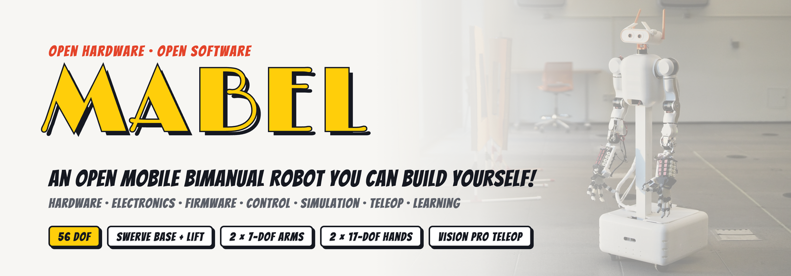
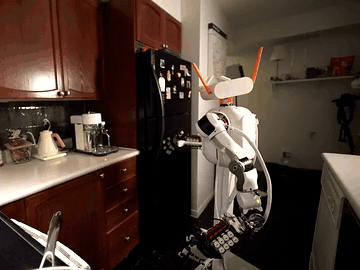
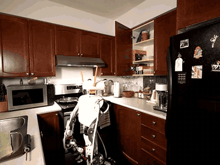
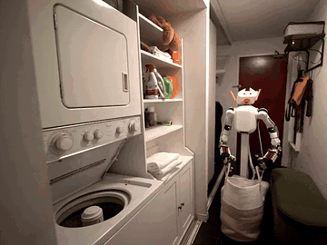
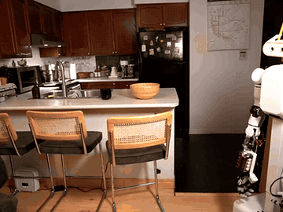
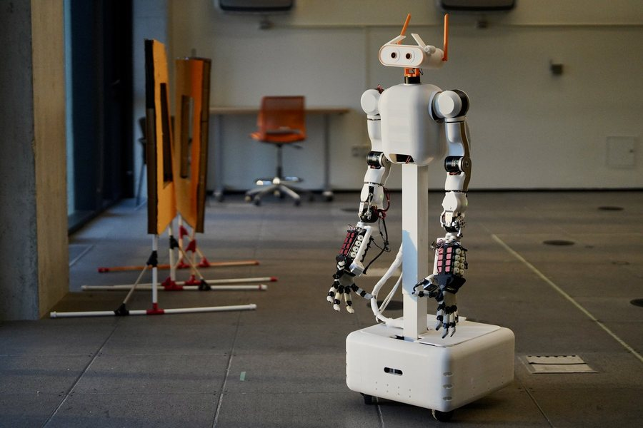
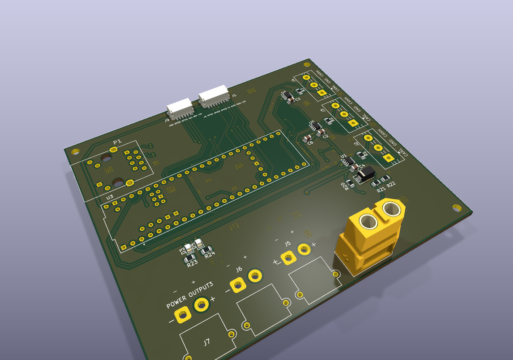

<p align="center"><picture><source media="(prefers-color-scheme: dark)" srcset=".github/banner_dark.png"></picture></p>

# MABEL

**MABEL** is an open-source, 56-DOF mobile bimanual robot: a three-module swerve base, a
vertical lift, a pitching torso, a 3-DOF active head with stereo cameras, two 7-DOF arms
(OpenArm-derived) and two 17-DOF anthropomorphic hands (ORCA-derived). It is teleoperated
whole-body from a single Apple Vision Pro, without hand-held controllers.

This repository holds everything needed to build your own MABEL and run it. The guide
below walks through it in order: **simulate → teleoperate → collect data → train → build the
hardware → bring up the real robot.** You can stop after any step; steps 1–5 need no hardware.

Project page: <https://robotmabel.github.io/website/>

<table><tr>
<td></td>
<td></td>
<td></td>
<td></td>
</tr></table>

---

## Contents

- [Repository layout](#repository-layout)
- [Step 1 — Install](#step-1--install)
- [Step 2 — Run the robot in simulation](#step-2--run-the-robot-in-simulation)
- [Step 3 — Teleoperate with the Vision Pro](#step-3--teleoperate-with-the-vision-pro)
- [Step 4 — Collect demonstrations](#step-4--collect-demonstrations)
- [Step 5 — Curate data and train a policy](#step-5--curate-data-and-train-a-policy)
- [Step 6 — Build the hardware](#step-6--build-the-hardware)
- [Step 7 — Flash firmware and bring up the buses](#step-7--flash-firmware-and-bring-up-the-buses)
- [Step 8 — Calibrate](#step-8--calibrate)
- [Step 9 — Bring up the real robot](#step-9--bring-up-the-real-robot)
- [Step 10 — Connect over Tailscale (optional)](#step-10--connect-over-tailscale-optional)
- [Step 11 — Change the robot model](#step-11--change-the-robot-model)
- [Architecture](#architecture) · [Licensing](#licensing)

---

## Repository layout

```text
open_mabel/
├── hardware/            Bill of materials, build guide, full-robot CAD (STEP)
├── electrical/          Base carrier PCB: KiCad sources, schematic, Gerbers/drill
├── firmware/            MCU firmware + host drivers: swerve base, arms/torso/neck, lift, ORCA hands
├── hardware_bridge/     The HAL (`mabel_hw`): the only process that opens a device
├── controller/          The `mabel` control library: whole-body control, retargeting, safety gate
├── server/              Teleop gateway: one wire contract (ws :9090), video, recording
├── ros/                 ROS 2 Jazzy workspace: URDF, SLAM, Nav2, thin hardware clients
├── simulation/          Canonical MuJoCo model + 30 scenes
├── simulation_bridge/   MuJoCo HAL — the simulated twin of hardware_bridge
├── web_gui/             Browser studios: real/sim control centers, control lab, retarget lab
├── apps/                iOS and Apple Vision Pro teleoperation apps
├── sensors/             Camera bring-up (RealSense D405, ZED Mini)
├── calibration/         Actuator and arm system identification
└── robot_learning/      Imitation learning (curation → LeRobot → ACT/DP/π0) and RL (mjlab)
```

Every folder has a `README.md`; most also ship a technical report in `<folder>/docs/*.pdf`
with the equations, parameters and measured results.

---

## Step 1 — Install

Requirements: Python ≥ 3.10, Git. macOS or Ubuntu for simulation; Ubuntu 24.04 on an NVIDIA
Jetson for the real robot. A CUDA GPU is only needed for policy training and RL.

```bash
git clone <this-repo> open_mabel && cd open_mabel
conda create -n mabel python=3.11 -y && conda activate mabel

pip install -e controller/                 # the `mabel` control library
pip install -r server/requirements.txt     # gateway, cameras, MuJoCo
```

Check the install — the model should load with 67 qpos, 66 qvel, 59 actuators:

```bash
python3 -c "import mujoco; m = mujoco.MjModel.from_xml_path('simulation/mabel_mujoco/models/mabel_full.xml'); print(m.nq, m.nv, m.nu)"
python3 -m pytest controller/tests -q
```

The launch scripts look for an Anaconda interpreter in your home directory; set
`MABEL_PY=$(which python3)` to use the active environment instead.

---

## Step 2 — Run the robot in simulation

```bash
bash server/run.sh
```

This starts the MuJoCo twin (`simulation_bridge/`), the rendered robot cameras, the teleop
gateway on `:9090`, and the **Simulation Control Center** web studio. Open
<http://localhost:8097> to see the robot in 3-D, drive it with keyboard, gamepad or your
webcam, switch scenes, and send navigation goals. Press `q` in the terminal to stop
everything.

Useful variants:

```bash
bash server/run.sh -s simulation/mabel_mujoco/scenes/mabel_kitchen_fk.xml   # another scene
bash server/run.sh --test       # open field + table + graspable objects, with the MuJoCo viewer
bash server/run.sh --viewer     # also open the native MuJoCo window
bash server/run.sh --mock       # synthetic operator hands, no headset needed
```

Without the gateway, you can drive the model directly in the MuJoCo viewer:

```bash
cd simulation/mabel_mujoco
mjpython scripts/keyboard_teleop.py            # whole-body keyboard teleop
mjpython scripts/compliance.py --region whole  # push the robot around; compliant whole body
```

More: [`server/README.md`](server/README.md), [`simulation/README.md`](simulation/README.md),
[`web_gui/README.md`](web_gui/README.md).

---

## Step 3 — Teleoperate with the Vision Pro

1. Open the app in Xcode: `open apps/visionos/MabelTeleop.xcodeproj`.
2. In *Signing & Capabilities*, choose your own development team and change the bundle
   identifier from `org.example.MabelTeleop-V2` to your own namespace.
3. Build and run the **MabelTeleop** scheme on your Vision Pro.
4. Keep `bash server/run.sh` running on a computer on the same Wi-Fi. The app finds the
   gateway over Bonjour (`_mabel-teleop._tcp`); otherwise add it by IP in
   Settings → **Add robot**.
5. Enter the immersive whole-body mode: your head drives the neck and torso, your wrists the
   arms, your fingers the ORCA hands, and the drive pad the base. The stereo head camera is
   shown in front of you.

The same app drives the real robot unchanged (Step 9). Details, routes
(Wi-Fi LAN, Tailscale, Bluetooth) and tests: [`apps/visionos/README.md`](apps/visionos/README.md).
The iPhone app in [`apps/ios/`](apps/ios/README.md) speaks the same protocol and connects the same way.

---

## Step 4 — Collect demonstrations

**In simulation.** With `bash server/run.sh` running, start and stop recording from the
studio or the Vision Pro app. The gateway writes one HDF5 file per episode:

```text
dataset/simulation/vision_os/<task>/episode_XXXX.h5
```

Each frame stores every camera (JPEG RGB, uint16 depth), LiDAR, joint position/velocity/
torque, base twist, end-effector poses and the command sent to every actuator.

**On the real robot.** Run the collector next to the bring-up (Step 9); the app's record
button points at it:

```bash
python3 server/real_curation_collector.py --client visionos --control-port 9095
```

Sim and real episodes share one format. More:
[`server/docs/data_collection.md`](server/docs/data_collection.md).

---

## Step 5 — Curate data and train a policy

Training runs LeRobot in its own environment (torch + CUDA). Point MABEL at it once:

```bash
export MABEL_LEROBOT_PYTHON=/path/to/lerobot-env/bin/python
cd robot_learning
```

1. **Curate** — score episode quality and export a LeRobot dataset:
   ```bash
   HDF5_USE_FILE_LOCKING=FALSE python3 curate_export.py \
       --sessions '../real/vision_os/pick_place_*' --out-name pick_place --realm real
   ```
   For interactive review and trimming, run the Data Curation studio:
   `MABEL_DATASET_ROOT=../real/vision_os python3 -m data_curation.server` → <http://127.0.0.1:8093>.
2. **Train** — ACT, Diffusion Policy (`DP`), π0 or π0.5:
   ```bash
   python3 -m training_studio.server.mabel_train list-datasets
   python3 -m training_studio.server.mabel_train train --arch ACT \
       --dataset pick_place_001_<date> --steps 20000 --batch 8 --device cuda
   ```
3. **Evaluate / resume:**
   ```bash
   python3 -m training_studio.server.mabel_train eval   --run <run_id> --episodes 3
   python3 -m training_studio.server.mabel_train resume --run <run_id> --steps 40000
   ```

The Training Studio (`python3 -m training_studio.server`, <http://localhost:8095>) does the
same with live loss curves and closed-loop deployment in MuJoCo. Full walkthrough:
[`robot_learning/PIPELINE.md`](robot_learning/PIPELINE.md).

**Reinforcement learning** (GPU): MABEL tasks on mjlab (Isaac-Lab-style API on MuJoCo-Warp),
including whole-body control (arm + hand + lift + torso):

```bash
cd robot_learning/reinforcement_learning/mjlab && uv sync
uv run play  Mjlab-Lift-Cube-Mabel --agent zero                 # sanity check
uv run train Mjlab-Lift-Cube-Mabel --env.scene.num-envs 4096    # PPO, arms only
uv run train Mjlab-Lift-Cube-Mabel-WholeBody --env.scene.num-envs 4096   # whole-body PPO
```

---

## Step 6 — Build the hardware

<p align="center"> </p>

1. **Order parts.** [`hardware/bom/MABEL_Build_Guide.pdf`](hardware/bom/MABEL_Build_Guide.pdf)
   lists every part with vendor links and three build tiers; the costed BOM is
   [`hardware/bom/mabel_bom.pdf`](hardware/bom/mabel_bom.pdf) (source of truth:
   `hardware/bom/data/core.csv`).
2. **Build the upstream sub-assemblies.** Arms from
   [OpenArm](https://github.com/enactic/openarm_hardware), hands from the
   [ORCA Hand](https://github.com/orcahand/orcahand_hardware), three REV MAXSwerve modules,
   and the lift column — see [`hardware/README.md`](hardware/README.md).
3. **Make the MABEL parts.** Unzip `hardware/cad/MABEL_full_assembly.step.zip` and print or
   machine the custom parts from the full-robot STEP assembly.
4. **Fabricate the base carrier board.** Zip `electrical/Motherboard/fab/` and order it from
   any 2-layer PCB service; parts are in `electrical/exports/Motherboard_schematic.pdf`.
   See [`electrical/README.md`](electrical/README.md).

---

## Step 7 — Flash firmware and bring up the buses

```bash
# Swerve base and arms/torso/neck — Teensy 4.1, PlatformIO
cd firmware/swerve_drive && pio run -e teensy41 -t upload && cd -
cd firmware/openarm_dual && pio run -t upload && cd -     # copy config/robot.json to its SD card

# Lift — Raspberry Pi Pico, MicroPython
pip install mpremote && firmware/lift/tools/deploy.sh

# ORCA hands — no flashing; check the 17 servo IDs per hand
python3 firmware/orca_hand/feetech/scripts/scan.py

# CAN (SocketCAN) — bring up and ping the DaMiao motors
firmware/can_up.sh --ping
```

Before first use, verify each DaMiao motor's `(p_max, v_max, t_max)` in the vendor tool — a
mismatch silently rescales every value on the wire. More: [`firmware/README.md`](firmware/README.md).

---

## Step 8 — Calibrate

```bash
pip install -r calibration/requirements.txt
calibration/motor_calibration/hardware/scan.sh                     # list motors (does not energise)
calibration/motor_calibration/hardware/run_hardware.sh DM-J4310 2  # friction/inertia ID of one motor
cd hardware_bridge && python3 -m mabel_hw.drivers.orcahand.calibrate --model left   # hand end-stop sweep
```

Encoder windows, joint directions and gravity feed-forward live in
[`hardware_bridge/calibration_data/mabel.json`](hardware_bridge/calibration_data/); every
driver reads them from there. Procedures: [`calibration/README.md`](calibration/README.md).

---

## Step 9 — Bring up the real robot

On the robot computer, build the ROS 2 workspace once:

```bash
cd ros && ./dev_up.sh        # conda env (RoboStack ROS 2 Jazzy) + colcon build
```

Then, from the repository root:

```bash
bash server/real_run.sh      # HAL + ROS clients + cameras + SLAM + Nav2 + gateway + Control Center
```

Open the Control Center at `http://<robot-ip>:8094`, or connect the Vision Pro app.
Subsystems without hardware stay idle; `--no-arms`, `--no-base`, `--only-hands`, etc. bring
up a subset (`bash server/real_run.sh -h`).

**Safety.** Arms come up limp; torque is enabled explicitly by the operator. Every base
twist passes the tip-over gate, which limits speed by lift height. Know where your e-stop is
before enabling torque. Read [`hardware_bridge/README.md`](hardware_bridge/README.md) (safety
section) and [`controller/README.md`](controller/README.md) first.

---

## Step 10 — Connect over Tailscale (optional)

On the same Wi-Fi the apps and browser connect directly (Bonjour discovery or the host's LAN
IP). To reach the robot from another network, install [Tailscale](https://tailscale.com) on
the robot host and on each client device, sign them into the same tailnet, and use the robot
host's `100.x.y.z` address wherever you would use its LAN IP. The protocol and ports are
identical; nothing is exposed to the public internet. To require an access code, start the
server with `MABEL_TOKEN=<your-code>` and enter the same code in the client. Details:
[`server/README.md`](server/README.md).

---

## Step 11 — Change the robot model

`simulation/mabel_mujoco/models/mabel_full.xml` is the single source of truth. After editing
it, regenerate the derived artifacts in order:

```bash
python3 ros/src/mabel_description/scripts/mjcf_to_urdf.py \
  --mjcf simulation/mabel_mujoco/models/mabel_full.xml \
  --out  ros/src/mabel_description/urdf/mabel_full.urdf \
  --mesh-prefix package://mabel_description/meshes                      # 1. MJCF → URDF
python3 ros/src/mabel_description/urdf_to_glb.py                         # 2. URDF → web rig (web_gui/shared_assets/)
python3 simulation/tools/glb_to_rig.py                                   # 3. web rig → iOS + Vision Pro rigs
python3 controller/experiments/exp_front_workspace.py --phase W3 --build # 4. arm posture table
python3 controller/experiments/wbc_stability.py                          # 5. check tip-over CoM constants
```

If step 5 reports more than ~1 cm of centre-of-mass error, update the constants in
`controller/mabel/motion_model/tip_over.py`.

---

## Architecture

Three rules hold for every data path:

1. **`hardware_bridge/` is the sole hardware owner.** Nothing else — ROS included — opens a
   bus, serial port or camera.
2. **`controller/` is the sole gate on motion.** Every command source (Vision Pro, browser,
   keyboard, gamepad, Nav2, a learned policy) is a client of one wire contract
   (`server/wire_protocol.py`); every base twist passes `safe_base_step(...)`.
3. **The MJCF is the single source of truth** for geometry, inertia and limits.

```text
command : device ─▶ server (ws :9090) ─▶ controller ─▶ hardware_bridge ─▶ robot
state   : robot  ─▶ hardware_bridge ─▶ server ─▶ devices
video   : robot  ─▶ hardware_bridge ─▶ devices            (does not pass through server)
ros     : robot  ─▶ hardware_bridge ─▶ ROS 2 ─▶ SLAM / Nav2 / rviz
```

The simulated robot speaks the same contracts, so every client and the controller run
unchanged against the twin.

## Licensing

Software: Apache-2.0 ([`LICENSE`](LICENSE)). Hardware design files: CERN-OHL-S-2.0
([`LICENSE-HARDWARE.txt`](LICENSE-HARDWARE.txt)). Documentation and media: CC BY 4.0
([`LICENSE-DOCS.txt`](LICENSE-DOCS.txt)). Upstream components:
[`THIRD_PARTY_NOTICES.md`](THIRD_PARTY_NOTICES.md).
