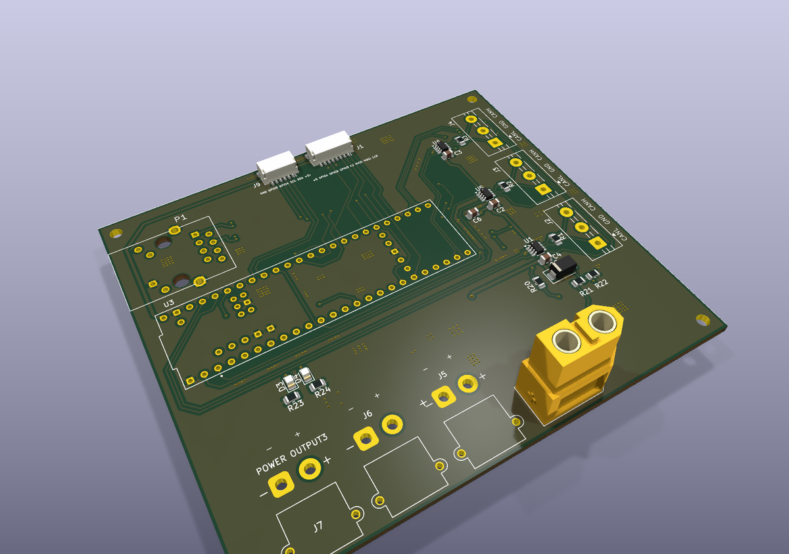
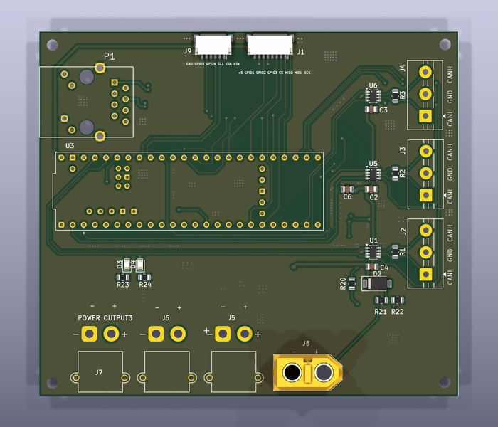
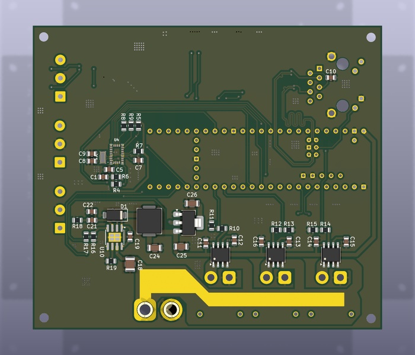

# electrical — base carrier board

<p align="center"></p>

The only custom PCB: a Teensy 4.1 carrier that runs the swerve base. Everything else is
off-the-shelf (see [`../hardware/bom/`](../hardware/bom/)).

| | |
|---|---|
| Function | 3× CAN (one per swerve module), Ethernet to the robot computer, 24 V to three XT30 outputs, BNO085 IMU (SPI) |
| Board | 2 layers, 95.55 × 83.05 mm, 1.6 mm, KiCad 10 |
| Status | Fabricated and bench-validated (flash, Ethernet, all three CAN buses) |

| Top | Bottom |
|---|---|
|  |  |

## Files

```text
Motherboard/            KiCad project: schematic sheets (power, can, untitled = IMU), layout, parts/
Motherboard/fab/        Gerbers + drill — what was fabricated
exports/                schematic PDF, layout PDF, top/bottom SVG, assembled-board STEP
```

## Order and assemble

1. Zip `Motherboard/fab/` and upload it to any 2-layer PCB service (stack-up in `fab/Motherboard-job.gbrjob`).
2. Source parts from the schematic (`exports/Motherboard_schematic.pdf`) and the BOM.
3. Flash the firmware: [`../firmware/swerve_drive/`](../firmware/swerve_drive/).

`CAN_Transiever.kicad_sch` and `IMU.kicad_sch` are unused stubs.
