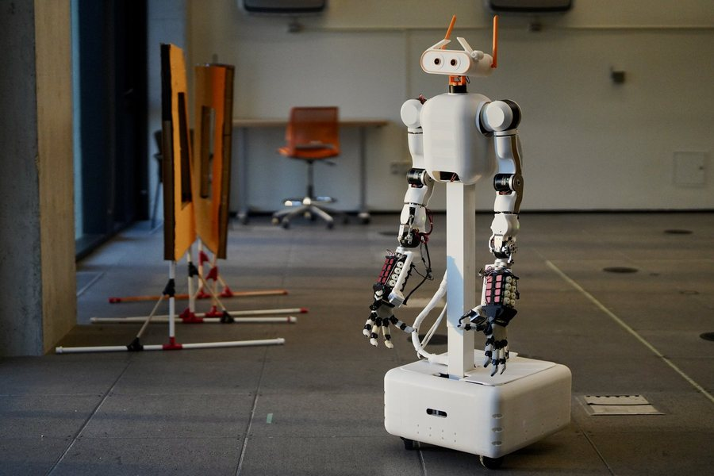

# hardware — bill of materials and CAD

<p align="center"></p>

```text
bom/    Bill of materials + build guide (MABEL_Build_Guide.pdf, mabel_bom.pdf, data/*.csv)
cad/    Full-robot assembly, STEP (zipped)
```

## Build in four steps

1. **Order parts** from [`bom/MABEL_Build_Guide.pdf`](bom/MABEL_Build_Guide.pdf) — vendor links and
   the three reference builds (Essential / Recommended / Maximum). `bom/data/core.csv` is the
   source of truth; regenerate the PDFs and figures with `cd bom && python3 tools/build_bom.py`.
2. **Open the CAD**: `unzip cad/MABEL_full_assembly.step.zip` and import the STEP into any CAD tool
   (Fusion, SolidWorks, Onshape, FreeCAD). Print or machine the custom parts from it.
3. **Build the upstream sub-assemblies** as published:

   | Sub-assembly | Source |
   |---|---|
   | 7-DOF arms | [OpenArm](https://github.com/enactic/openarm_hardware) |
   | 17-DOF hands | [ORCA Hand](https://github.com/orcahand/orcahand_hardware) |
   | Swerve modules | REV MAXSwerve (commercial) |
   | Lift | commercial linear column |

4. **Wire it up**: base carrier PCB in [`../electrical/`](../electrical/), firmware in
   [`../firmware/`](../firmware/).

Per-link meshes of the whole robot are also in
[`../simulation/mabel_mujoco/assets/meshes/`](../simulation/mabel_mujoco/assets/meshes/).
